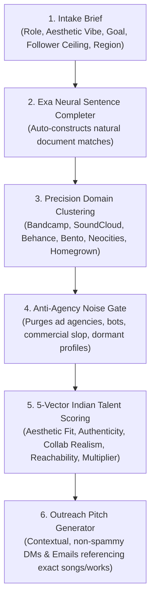

# indie-talent-scout (Codename: Undercurrent)

[](https://opensource.org/licenses/MIT)
[](https://www.python.org/downloads/)
[](https://exa.ai)
[](https://github.com/SriramKintada/indie-talent-scout/pulls)

**Autonomous creative talent and subculture scouting engine for India.**

Discover underground Indian indie singers, bedroom producers, sound designers, brand identity craftsmen, and visual illustrators using **Exa AI Neural Search**. Built for startup founders, early-stage operators, and creative directors looking to assemble exceptional creative teams without bloated agency fees or algorithmic vanity metrics.

```
       ___          ___         _____          ___     
      /  /\        /__/\       /  /::\        /  /\    
     /  /:/        \  \:\     /  /:/\:\      /  /:/_   
    /__/::\         \  \:\   /  /:/  \:\    /  /:/ /\  
    \__\/\:\    ___  \  \:\ /__/:/ \__\:|  /  /:/ /:/_ 
       \  \:\  /__/\  \__\:\\  \:\ /  /:/ /__/:/ /:/ /\
        \__\/  \  \:\ /  /:/ \  \:\  /:/  \  \:\/:/ /:/
                \  \:\  /:/   \  \:\/:/    \  \::/ /:/ 
                 \  \:\/:/     \  \::/      \  \:\/:/  
                  \  \::/       \__\/        \  \::/   
                   \__\/                      \__\/    
```

---

## The Problem

Finding high-taste, lowkey creative talent in India today is broken:

1. **Algorithmic Vanity:** Instagram and Spotify algorithms favor high-frequency content farms and commercial reels over raw artistic craft.
2. **Agency Overhead:** Traditional agencies charge ₹5L to ₹15L for creative work, taking massive cuts while paying the actual young artists pennies.
3. **LinkedIn Silence:** Truly gifted bedroom musicians, Indic type designers, and dark-surrealist illustrators do not post corporate updates on LinkedIn. They live on Bandcamp, Behance, Neocities, Bento, and underground zines.
4. **Western Tool Blindness:** Existing A&R and talent scrapers are trained on Western electronic clubs (UK bass, Berlin techno) and completely miss the nuances of Indian creative subcultures.

`indie-talent-scout` fixes this by treating Exa AI neural search as an **aesthetic document completer**, scanning verified creative platforms and scoring candidates across a dedicated 5-vector rubric.

---

## Architecture



---

## 5-Vector Evaluation Rubric (Max Score: 50)

Every scouted creator is evaluated across 5 dimensions from 0 to 10:

| Vector | What It Evaluates | High Score Signal (9-10) |
| :--- | :--- | :--- |
| **1. Aesthetic Fit** | Resonance with your target sonic or visual style | Rare craft, zero stock templates, bespoke identity |
| **2. Authenticity** | Underground integrity vs algorithmic trend chasing | Under 25k followers, distinctive personal obsession |
| **3. Collab Realism** | Independent ownership and commercial viability | Self-managed, explicitly open for projects/commissions |
| **4. Reachability** | Directness of contact route | Direct email in bio, Linktree WhatsApp, open DMs |
| **5. Value Multiplier** | Perceived lift to your startup or application | Brand-defining asset, users ask "who created this?" |

### Priority Bands
* **High Priority:** Total score >= 38 / 50 (immediate outreach)
* **Medium Priority:** Total score 28 to 37 / 50 (strong backup)
* **Low Priority:** Total score < 28 / 50 (archived)

---

## Installation

### From Source
```bash
git clone https://github.com/SriramKintada/indie-talent-scout.git
cd indie-talent-scout
pip install -e .
```

### Requirements
```bash
pip install -r requirements.txt
```

---

## Quickstart

### 1. Set your Exa API Key
Get your free API key at [exa.ai](https://exa.ai) and export it:
```bash
export EXA_API_KEY="your-exa-api-key"
```
On Windows PowerShell:
```powershell
$env:EXA_API_KEY="your-exa-api-key"
```

### 2. Run the CLI

#### Scout Indian Indie Singers & Bedroom Pop Artists
```bash
indie-talent-scout --role music --vibe "dreamy acoustic hindi bedroom pop" --region "Delhi"
```

#### Scout Visual Designers & Indic Type Illustrators
```bash
indie-talent-scout --role design --vibe "dark surrealism visual art" --region "Kerala"
```

#### Scout Founding Designers for Early-Stage Startups
```bash
indie-talent-scout --role ui --vibe "minimalist brutalist typography" --region "Bangalore" --app-name "MySaaS"
```

#### Generate Exa Search Parameters Without Running Live API (Prompt-Only Mode)
```bash
indie-talent-scout --role singer --vibe "wistful acoustic folk" --format prompt-only
```

---

## CLI Options

```text
options:
  -h, --help            Show this help message and exit
  --role {music,singer,producer,sound,design,designer,illustrator,ui,brand,all}
                        Creative role archetype to scout (default: music)
  --vibe VIBE           Specific aesthetic, sound, or visual style description
  --region REGION       Geographic scene (e.g. India, Bangalore, Delhi, Kerala)
  --count COUNT         Number of prospects to return (1-20, default: 5)
  --app-name APP_NAME   Name of your app/startup for outreach generation
  --format {table,json,markdown,prompt-only}
                        Output format (default: table)
```

---

## Python SDK Usage

```python
from indie_talent_scout import IndieScoutEngine

# Initialize engine (reads EXA_API_KEY from environment)
engine = IndieScoutEngine()

# Scout prospects
prospects = engine.scout(
    vibe="dreamy 80s synth bedroom pop",
    role="music",
    region="Delhi",
    count=5,
    app_name="Aura Audio",
    sender_name="Sriram"
)

for p in prospects:
    print(f"[{p.evaluation.score_total}/50 | {p.evaluation.outreach_priority}] {p.creator_name}")
    print(f"URL: {p.primary_portfolio_or_stream_url}")
    if p.outreach:
        print(f"DM Pitch:\n{p.outreach.instagram_dm}\n")
```

---

## AI Agent Skill (Claude, OpenClaw, Antigravity)

This repository includes a standalone agent skill. Copy `skill/indie-talent-scout/` into your active agent workspace:

```bash
# For Claude Code / OpenClaw
cp -r skill/indie-talent-scout ~/.claude/skills/

# For Antigravity / Agents
cp -r skill/indie-talent-scout ~/.agents/skills/
```

Once installed, simply ask your agent in plain English:
> *"Find 4 lowkey Indian indie singers on Bandcamp with under 10k listeners for our launch video soundtrack."*

---

## Indian Creative Scene Atlas

| Scene Hub | Musical Signature | Design & Visual Art Signature |
| :--- | :--- | :--- |
| **Delhi-NCR** | Bedroom pop, self-aware indie pop, alt-hip-hop | Contemporary brutalism, street fashion graphics |
| **Bangalore** | Shoegaze, dream-pop, synthwave, psych-rock | Digital product craft, Swiss grid, Srishti zine culture |
| **Kerala (Kochi/Calicut)** | Dark surrealist electronic, Malayalam alt-rap | Dark surrealism, photo manipulation, cinema graphics |
| **Northeast (Shillong/Imphal)** | Pristine acoustic soul, choral harmonies, alt-rock | Nature-inspired hand illustration, textile patterns |
| **Mumbai & Pune** | Soulful acoustic indie, jazz-funk, Hindi indie | Bollywood retro revival, packaging design, NID modernism |

---

## Sample Discovered Talent

Here are real underground artists and designers surfaced during live validation:

* **Arjun C** ([Instagram @arjunc13](https://instagram.com/arjunc13)): Delhi-based bedroom pop and 80s synth-pop singer behind *Sense of Human*.
* **Abhilasha Sinha** ([Bandcamp](https://abhilashasinha.bandcamp.com/track/honey-bee)): Soulful acoustic songwriter behind *Honey Bee*.
* **Geetanjali K** ([Behance](https://www.behance.net/geetanjali)): Bangalore-based editorial illustrator with just 37 followers and remarkable line craft.
* **Alfred / vyvy0013** ([Neocities](https://vyvy0013.neocities.org/)): Kerala-based dark surrealist artist working outside mainstream commercial templates.

See [examples/sample_shortlists/](examples/sample_shortlists/) for full dossiers.

---

## Contributing

Pull requests are welcome! If you want to add new Indian cultural scene hubs, domain presets, or outreach templates:

1. Fork the repository
2. Create your feature branch (`git checkout -b feature/amazing-feature`)
3. Commit your changes (`git commit -m 'Add new scene node'`)
4. Push to the branch (`git push origin feature/amazing-feature`)
5. Open a Pull Request

---

## License

Distributed under the MIT License. See [LICENSE](LICENSE) for more information.

Maintained by **[Sriram Kintada](https://github.com/SriramKintada)**.
