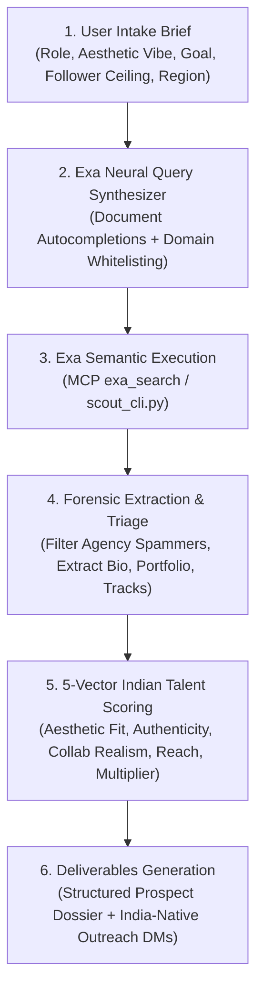

# Indie Talent Scout (Codename: "Undercurrent")
### Autonomous Creative Talent & Subculture Scouting Engine for India

`indie-talent-scout` is a specialized discovery and outreach engine. It leverages **Exa AI's Neural Search** to bypass commercial noise, vanity follower metrics, and generic agency rosters - surfacing underground, high-craft Indian musicians, singers, sound designers, illustrators, brand craftsmen, and UI/UX artists.

---

## 1. Core Architecture



---

## 2. Who This Is For & Target Use Cases

| User Persona | Typical Mission | Target Creative Archetypes | Primary Discovery Domains |
| :--- | :--- | :--- | :--- |
| **Early-Stage Startup Founders** | Building an iconic brand identity, landing page illustrations, or app launch video without paying ₹10L+ to agencies. | Visual Illustrators, Indic Type Designers, Motion Designers, Brand Identity Craftsmen | `behance.net`, `bento.me`, `readcv.com`, `layers.to`, `homegrown.co.in` |
| **Team Builders & Hiring Leads** | Recruiting high-agency Founding Designers, Lead Product Designers, or Creative Leads who possess genuine taste. | UI/UX Craftsmen, Creative Coders, Interaction Designers, Product Designers | `readcv.com`, `bento.me`, `layers.to`, `neocities.org` |
| **Growth & Marketing Operators** | Sourcing an authentic soundtrack, sonic branding (app chimes/earcons), or viral reel collaboration. | Bedroom Pop Singers, Lo-Fi Producers, Sound Designers, Alt-Hip Hop Lyricists | `bandcamp.com`, `soundcloud.com`, `open.spotify.com`, `thewildcity.com`, `rollingstoneindia.com` |
| **Event Curators & Community Leads** | Booking raw, high-engagement musical acts or live illustrators for tech conferences, hacker houses, or pop-ups. | Indie Singer-Songwriters, Acoustic Duos, Live Visual Projection Artists | `bandcamp.com`, `youtube.com`, `homegrown.co.in` |

---

## 3. Step-by-Step Execution Workflow

### Step 1: Intake & Creative Parameterization
Extract or clarify the 5 core parameters from the user's brief:
1. **Creative Archetype:** 
   * *Music/Audio:* Indie Singer-Songwriter, Bedroom Pop Producer, Audio UX / Sound Designer, Desi Alt-Hip-Hop, Acoustic Folk.
   * *Visual/Design:* Brand Identity Designer, Editorial Illustrator, Indic Typography Artist, UI/UX Craftsman, 3D / Motion Designer.
2. **Aesthetic / Vibe Target:** Reference concrete sonic or visual textures (e.g., *"warm vintage Hindi indie like Peter Cat or Parekh & Singh"*, *"minimalist dark-mode typography like Swiss grid meets Devanagari"*, *"maximalist Indian truck-art reimagined for modern streetwear"*).
3. **Audience / Scale Ceiling:**
   * `< 5,000` followers/listeners: Raw, undiscovered bedroom genius; highest response rate; extremely affordable.
   * `< 25,000` followers/listeners: Emerging scene presence; loyal micro-cult following; strong brand halo.
   * `< 50,000` followers/listeners: Established indie darling; requires professional scoping and budget.
4. **Collaboration Objective:** App soundtrack, hero section illustration, full-time founding hire, merchandise drop, or marketing campaign.
5. **Geographic Focus:** Pan-India, or regional scenes (Bangalore, Delhi-NCR, Kerala/Kochi, Northeast/Shillong, Mumbai/Pune).

---

### Step 2: Formulate Exa Neural Autocompletions
Exa excels when prompted with the **exact sentence that an authoritative curator or portfolio would write**, rather than search keywords.

#### Neural Query Blueprints:
* **For Music / Singers:**
  ```text
  "Here is an independent indie singer, music producer, or songwriter from [REGION] making [VIBE] music on Bandcamp, SoundCloud, or Spotify:"
  ```
* **For Design / Visual Arts:**
  ```text
  "Here is the portfolio of an independent graphic designer, visual illustrator, or UI craftsman based in [REGION] specializing in [VIBE]:"
  ```
* **For Curated Media Feats:**
  ```text
  "emerging independent [music artists / visual designers] India feature [VIBE]:"
  ```

#### Domain Whitelisting:
* **Music Clusters:** `include_domains: ["bandcamp.com", "soundcloud.com", "open.spotify.com", "homegrown.co.in", "thewildcity.com", "rollingstoneindia.com", "youtube.com"]`
* **Design Clusters:** `include_domains: ["behance.net", "bento.me", "readcv.com", "layers.to", "neocities.org", "homegrown.co.in", "platform-mag.com"]`

---

### Step 3: Execute Exa Discovery

#### Option A: Via Antigravity / OpenClaw Native MCP (Recommended in Chat)
Call the `exa_search` tool:
```json
{
  "ServerName": "exa",
  "ToolName": "exa_search",
  "Arguments": {
    "query": "Here is an independent indie singer songwriter from India making lowkey soulful acoustic or dreampop music:",
    "type": "neural",
    "include_domains": ["bandcamp.com", "soundcloud.com", "open.spotify.com", "homegrown.co.in"],
    "num_results": 8
  }
}
```

#### Option B: Via Bundled CLI Script
Run from terminal or bash:
```powershell
python c:\Users\kinta\clawd\.agents\skills\indie-talent-scout\scripts\scout_cli.py --role music --vibe "dreamy bedroom pop synthwave" --region "Delhi" --count 5
```

---

### Step 4: Verification & Anti-Spam Gate
Before presenting any candidate, apply the **3 Elimination Rules**:
1. **No Agency Fronts / Aggregators:** Discard digital marketing agencies, commercial sound libraries, playlist curators, or design studios masquerading as individual artists.
2. **No Dormant Ghosts:** The creator must have posted or released music/art within the last 12-18 months.
3. **No Follower Vanity:** Discard profiles with inflated/botted followings or major label contracts if the user requested lowkey/indie collaborators.

---

### Step 5: Score Candidates with 5-Vector Rubric (Max 50)
Score each candidate using `references/scoring_rubric.md`:
* **Taste & Aesthetic Fit (0-10):** Does their catalog match the user's brief?
* **Underground Authenticity (0-10):** High craft, zero algorithmic trend-chasing.
* **Collab Realism (0-10):** Open to freelance/contracts/licensing, independent ownership of rights.
* **Reachability (0-10):** Public email in bio, Instagram DM open, or Linktree contact route.
* **Marketing Multiplier (0-10):** Perceived brand value lift when integrated into product/app.

**Priority Bands:**
* **High (`High`):** Total $\ge 38$
* **Medium (`Medium`):** Total $28-37$
* **Low (`Low`):** Total $< 28$

---

### Step 6: Generate Deliverables Package

Deliver two concrete outputs to the user:

#### 1. Structured Talent Dossier
Present a Markdown table with:
* **Creator Name & Base City**
* **Role & Primary Style**
* **Direct Links:** Portfolio / Bandcamp / Spotify / Behance URL
* **Signature Work to Reference:** The exact track or Behance project that proves fit
* **Follower / Listener Scale:** Proof of lowkey status
* **5-Vector Total Score & Priority**

#### 2. Personalized First-Contact Pitch Drafts
Generate tailored outreach messages using `templates/outreach_playbook.md`:
* **Instagram DM Variant:** 3-4 short sentences, praising a specific song/artwork, introducing the startup, proposing paid collab.
* **Email Variant:** Structured pitch with scope, timeline, compensation clarity, and creative autonomy.

---

## 4. Supporting Resources
* **Evaluation Framework:** `references/scoring_rubric.md`
* **Scene Guide & Cultural Nodes:** `references/indian_creative_clusters.md`
* **Outreach Templates:** `templates/outreach_playbook.md`
* **Prospect Schema:** `templates/prospect_schema.json`
* **CLI Utility:** `scripts/scout_cli.py`
